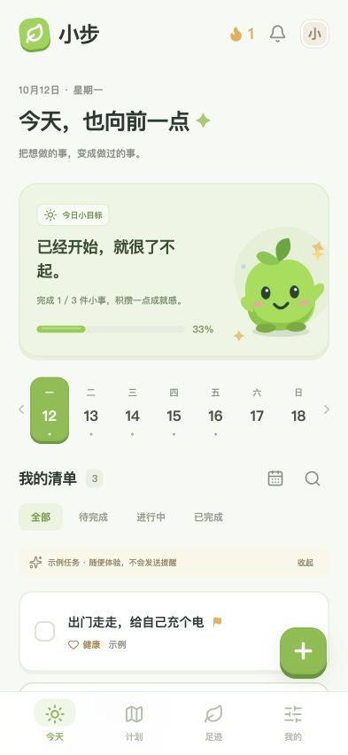
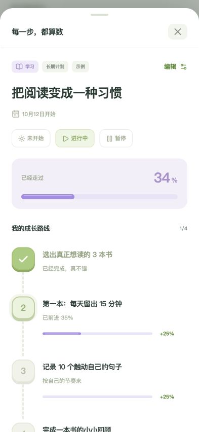

# 小步 · 每天一点，走得更远

个人任务管理 PWA，可在 iPhone 上添加到主屏幕使用。数据保存在自己的服务器，支持 Web Push 提醒。

## 当前功能

- 每日计划、长期计划、里程碑节点与进度管理
- 每天或工作日重复任务、搜索、完成统计及回收站
- 到期提醒、早晚汇总、免打扰时段与每日提醒上限
- 浅色／深色外观、完成动画及减少动态效果支持
- 手机通知连接、测试通知和服务端数据备份

当前仅实现任务插件。信息收集、减肥、理财、音乐等功能尚未开发。

## 界面

| 每日计划 | 长期计划 |
| --- | --- |
|  |  |

截图使用隔离的示例数据。

## 本地运行

需要 Node.js 22.16 或更高版本。

```sh
npm ci
npm run build
PUBLIC_ORIGIN=http://127.0.0.1:18788 DATA_DIR=./state npm start
```

打开终端显示的私人入口。首次启动会生成入口标识和推送密钥。`state/` 保存任务数据库和密钥，不纳入 Git。

```sh
npm test
```

测试使用隔离数据和模拟推送，不会向真实手机发送通知。

## 目录

| 路径 | 内容 |
| --- | --- |
| `src/` | React 界面、样式和交互动画 |
| `public/` | App 图标和 Service Worker |
| `server/` | Node.js API、SQLite 数据存储、提醒队列和备份 |
| `test/` | 任务、提醒、持久化和 HTTP 接口测试 |
| `deploy/` | systemd、Nginx、ZeroTier 和证书维护配置示例 |
| `docs/` | 界面参考、截图和历史验收记录 |

## 部署和手机安装

部署需要 HTTPS 域名。当前架构由公网 Nginx 通过 ZeroTier 转发到内网服务器；运行维护见 [README.txt](README.txt)。`deploy/` 中的域名和 IP 均为示例，使用前必须替换为自己的配置。

在 iPhone Safari 打开私人入口，选择“添加到主屏幕”，从桌面打开 App 后连接手机通知。Web Push 不需要付费 Apple Developer 会员。更换域名后需重新添加到主屏幕并授权通知。

私人入口拥有数据访问权限，请勿公开完整链接。代码仓库不包含实际任务、订阅信息、服务器密码或推送私钥。

`deploy/activate.sh` 和 `deploy/migrate-test.mjs` 用于已有通知测试服务的迁移，不是新服务器的通用安装脚本。

## 技术栈

React、Motion、Vite、Node.js、SQLite、Web Push。应用目前需要网络连接才能读取和保存数据；横幅展示也受手机网络、系统通知设置和专注模式影响。
