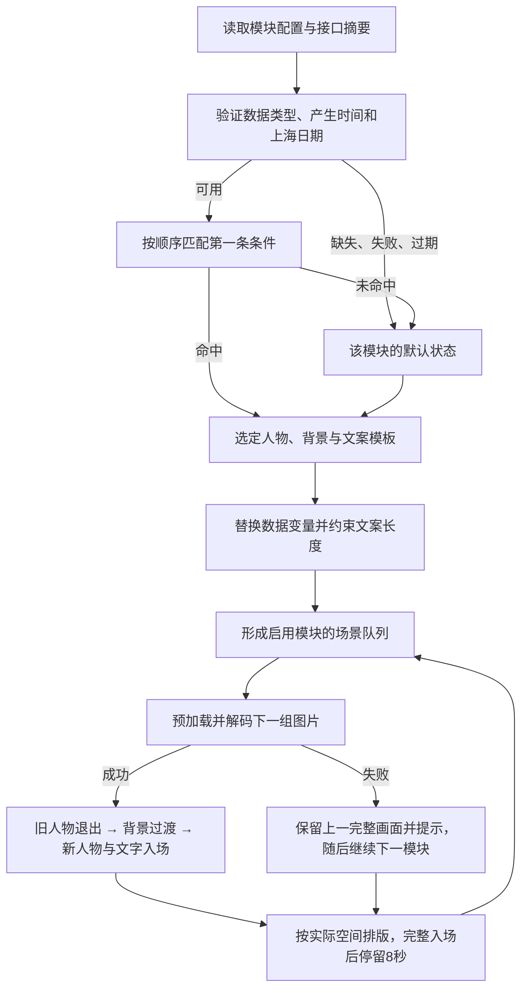

# 首页模块场景流程

每个模块拥有数据源、条件状态、人物、背景和文案。规则先确定该模块今天该展示什么，首页再轮流展示各模块的结果。同一理财模块不会同时把赚钱、亏钱两种状态加入自动轮播。

## 展示流程



后台、封面离开视口、打开浮层、手选预览或系统开启减少动态效果时，自动轮播暂停。回到前台会重新读取数据和时间。停留时间可设 4–60 秒；默认 8 秒不包括图片加载及过渡时间。只启用一个模块且只有一套文案时，保持其正确形象。

## 理财例子

| 数据 | 当前形象 | 背景 | 示例文案 |
| --- | --- | --- | --- |
| `todayProfit > 0` | 开心庆祝 | 暖阳庆祝插画 | 今日收益 +368.24 元 |
| `todayProfit < 0` | 温柔陪伴 | 雨后陪伴插画 | 今日收益 -15.00 元，慢一点也没关系 |
| `todayProfit === 0` | 平静问候 | 暖阳问候插画 | 今天先稳稳地走 |
| 缺失、失败、过期或非今天 | 中性阅读 | 安静书香插画 | 收益还在路上，稍后再来看看 |

这些人物、背景与文案都可在「设置 → 人物与模块场景」独立配置。规则支持数值大小比较及严格类型的文字／布尔等值比较；第一条匹配的规则生效。空值、字符串数字和接口错误不当成零收益。

## 文案排版

- 每个状态 1–3 套文案，再次轮到模块时依次使用。
- 模板最多 120 个可见字符、4 个非空手动换行；支持数据变量。
- 展开后最多 28 个可见字符、4 行；超出时明确省略。组合 emoji 按字素计数。
- 左侧使用封面宽度的 44% 安全区，实际测量字体后选择字号，最小 16px；特别窄的屏幕仍放不下时省略，不侵占人物区域。
- 短文案（不超过 16 字、2–4 段）优先保留手动分行，通过缩小字号保持语句完整；其余文案按中文词语换行，句末标点跟随前词，字号上限为 44px。
- 正负号、整数、小数作为一个金额整体换行。长数字无法容纳时保留省略号；完整文案保留在可访问名称中。
- 文本以纯文本渲染，模板不会执行 JavaScript 或 HTML。

| 写法 | 含义 |
| --- | --- |
| `{{todayProfit:money}}` | 带正负号的两位小数金额 |
| `{{todayProfit:absMoney}}` | 金额绝对值，可搭配“赚了／回撤”文案 |
| `{{newItems:integer}}` | 整数条数 |
| `{{字段名}}` | 自定义标量字段 |

## 新模块接入

1. 在设置中新增模块，填写名称和数据源标识，例如 `reading-plan`；可调整顺序、启停、有效期和关联卡片。
2. 添加条件状态，为每个状态选择人物、背景和文案；配置无数据或未命中时的默认状态。
3. 使用已实现的服务端定时接入器读取上游业务接口并转换摘要，或由业务侧主动写入下述接口。上游 URL、访问密钥与字段转换留在服务端，浏览器只读取标准摘要。配置方法见 [接口接入操作说明](scene-source-integration.md)。
4. 首页每 30 秒读取摘要，并在回到前台时刷新；每个模块只产生一个匹配结果。

内置 `daily` 数据由服务端按上海时区生成，不能从接口覆盖。理财 `finance`、资讯 `feed` 当前提供明确标注的演示摘要。收到实时摘要后，该源使用实时状态；实时源报错不会重新退回演示盈利。

模块最多 8 个，每模块最多 8 条规则。接口支持另外 8 个自定义数据源，每份摘要最多 20 个标量字段；字段值可为有限数字、布尔值或最多 96 个可见字符的字符串。

### 接口合同

`BASE` 表示现有私人入口，含末尾 `/`。接口沿用该入口及现有来源校验；私人入口不要放进公开仓库。

读取：`GET BASE + api/scene-data`。

写入：`POST BASE + api/scene-data/finance`，`Content-Type: application/json`。

```json
{
  "status": "ready",
  "values": {"todayProfit": -15, "totalProfit": 12680.52}
}
```

可选 `asOf` 为上游数据产生时间的 Unix 毫秒时间戳。服务端验证它不能晚于接收时间；规则优先按 `asOf` 判断有效期及上海日期。缺少它时按服务端接收时间判断。接入历史报表或缓存数据时必须提供真实 `asOf`，不要把重新接收旧报表当成生成新报表。

失败写入：`{"status":"error"}`。失败状态清空数值，首页显示该模块默认状态。接口不接受客户端伪造 `updatedAt` 或 `mode`；这两项由服务器生成。

读取结果示意：

```json
{
  "fetchedAt": 1791864000000,
  "snapshots": {
    "finance": {
      "status": "ready",
      "mode": "live",
      "updatedAt": 1791864000000,
      "values": {"todayProfit": -15, "totalProfit": 12680.52}
    }
  }
}
```

模块配置保存在 `settings.presentation`，通过原 `PATCH api/settings` 整体校验后保存。旧设置升级补齐默认模块，保留收藏、通知及原有偏好。数据摘要独立持久化，读取接口不会延长旧摘要有效期。

## 新人物与背景

现有六套素材保留。人物资源的统一注册表是 [scene-assets.mjs](../../shared/scene-assets.mjs)：新增条目及对应透明人物图、背景图片后，设置选择项和规则校验同步扩展。页面通过 `characterArt` 使用 WebP，原图留在 `src/home/art/`。

模块及数据接入可以直接通过现有配置与接口扩展；新图片资源需要加入项目并重新构建。当前没有提供图片上传或真实券商账户接入。业务接口由服务器本机配置固定地址，前端不能提交地址发起抓取。

## 实现与验证

- [scene-engine.mjs](../../shared/scene-engine.mjs)：配置校验、规则、数据时效、模板和队列。
- [scene-data.mjs](../../server/scene-data.mjs)：数据接入验证与摘要提供器。
- [scene-adapters.mjs](../../server/scene-adapters.mjs)：上游接口定时采集、字段映射、凭据引用与故障恢复。
- [useScenePlaylist.js](../../src/home/useScenePlaylist.js)：可见性、停留计时和文案轮换。
- [SceneCover.jsx](../../src/home/SceneCover.jsx)：预加载、有序转场及失败保留。
- [scene-view.mjs](../../src/home/scene-view.mjs)：整体场景与测量排版。
- [SceneSettings.jsx](../../src/home/SceneSettings.jsx)：模块、规则、人物、背景和文案配置。

自动化覆盖正负零、缺失与无效类型、上海跨天、过期和上游时间、数据持久化、升级、模板与配置边界、金额不拆行。浏览器检查覆盖默认轮换实际停留、快速数据更新、暂停恢复、资源失败恢复、窄屏排版和配置表单。浏览器使用本机 Chromium 模拟视口，不等同于手机真机测试。

2026-10-13 验收：33 项项目测试通过，场景行为 21 项及配置表单 18 项浏览器检查通过；默认完整入场后停留实测约 8.02 秒。最终 320／393px 金额完整换行，页面与设置无脚本错误，axe 检查未发现违规。

已更新服务器并经公网验证当前 JS/CSS、提示词库和模块数据接口，三个默认模块及 8 秒设置已生效。本次按要求开启自动轮换，保留私人入口、收藏、通知及其他设置；旧版本备份为 `/opt/lifehub-planner-backups/20261013-130412`。

界面留档：[亏损状态预览](module-scene-loss-preview.png)（本地模拟接口数据）、[场景配置预览](module-scenes-settings-preview.png)。
