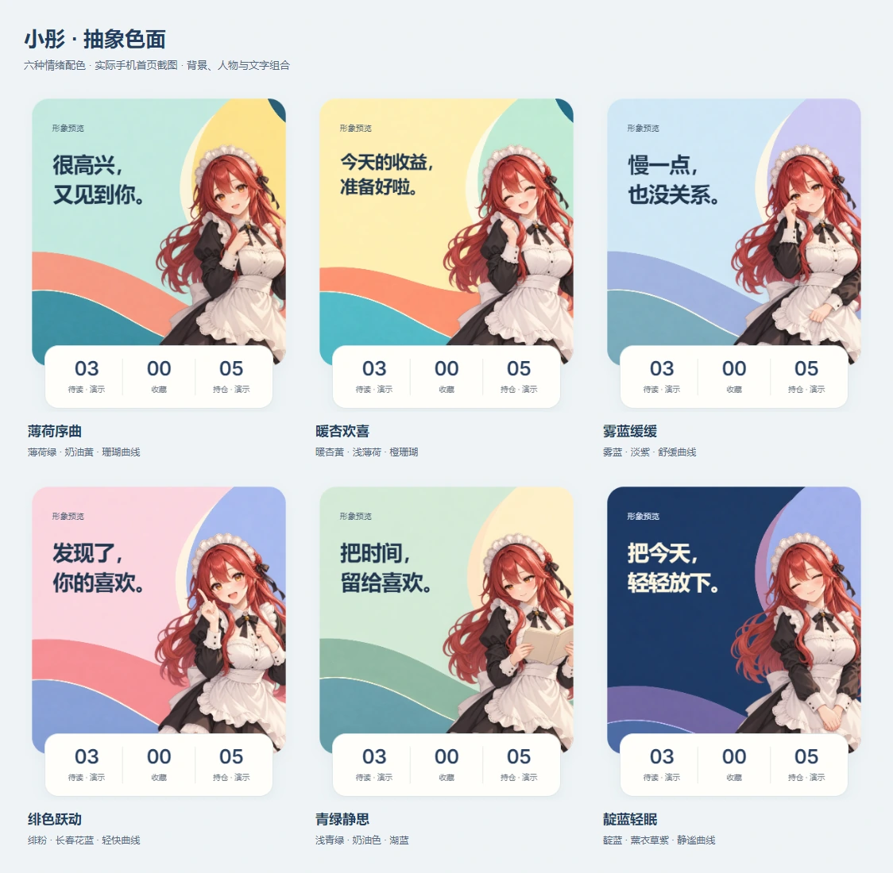

# V10 日系抽象色面

整理日期：2026-10-13。用户最新要求：「还是不喜欢这个背景，背景抽象点吧」。本轮在日系现代插画方向上去掉具象场景，改用大色面、流动曲线和轻纸纹。

## 设计取舍

人物表情负责具体情绪，背景通过冷暖、明暗与曲线节奏配合。背景不再出现窗户、书本、植物、硬币、饮料或星月；不在图内生成角色、文字或业务数字。保留透明人物与已有首页布局，避免同时改动角色辨识度和视觉结构。

先将问候稿放入真实首页，检查人物、文案、统计条和下方收益卡的关系，再以该稿为参考独立生成其余五张。背景采用约四至五块大色面，右侧裁切圆面衬托红发，底部宽曲线与一条细轮廓形成节奏，左侧留出文字空间。

| 状态 | 背景名 | 配色与节奏 |
| --- | --- | --- |
| 问候 | 薄荷序曲 | 薄荷底、奶油黄圆面、珊瑚与青蓝曲线 |
| 开心 | 暖杏欢喜 | 暖杏黄底、浅薄荷、橙珊瑚曲线 |
| 低落 | 雾蓝缓缓 | 雾蓝底、淡紫、舒缓的蓝青曲线 |
| 惊喜 | 绯色跃动 | 绯粉底、长春花蓝、轻快的珊瑚曲线 |
| 阅读 | 青绿静思 | 浅青绿底、奶油色、舒展的湖蓝曲线 |
| 晚安 | 靛蓝轻眠 | 靛蓝底、薰衣草紫、平缓蓝紫曲线 |

## 素材与接入

六张原图均为 1254 × 1254。内置 `image_gen` 生成，PNG 与 WebP 存放在 `src/home/art/scene-abstract-*-v10.*`；WebP 单张约 24–32 KiB。Pillow 仅用于格式转换。完整提示词、原始输出路径、项目文件名及尺寸记录在 [生成记录](v10-abstract-prompts.json)。旧版本素材保留，当前注册表仅引用 V10。

主文案从左侧 8%、顶部 19% 开始，宽 44%、高 44%，最多 28 个可见字符和 4 行，按实际测量适配 16–44px。浅色背景使用深蓝字，夜间使用奶白字。整体浅蓝纸面、白色统计条与内容卡片沿用 V9，盈利红、亏损绿。

模块规则、数据接口、自定义文案和轮播设置沿用现有实现。此次更换背景注册和预览名称，不改变人物与背景可独立配置的能力。

## 实际页面

## 验证结果

- 构建及 50 项现有测试通过，UI 资料库校验通过，仍为 31 条原创提示词、59 条来源评审。
- Chromium 在 320、393、768px 和 WebKit 在 393px 分别检查六个场景，共 24 个组合；没有横向溢出、意外裁切、文字越界或双人物。
- 320、393px 各检查盈利、亏损、最长文案、四行短句、数据不可用、夜间四行短句和夜间长文案，共 14 个组合；自动化可访问性扫描没有发现违规项。
- 按首页方形与手机裁切比例，对 WebP 图像上的标题安全区和小字区域逐像素计算对比度。初稿小字偏浅、夜间曲线偏高，因此将浅色场景标题调整为 `#20364f`、小字为 `#465a71`，并用内置 image_gen 将夜间底部曲线下移。修正后所检查区域的最低对比度为 4.82:1；此计算不等同于覆盖整站的人工无障碍审计。
