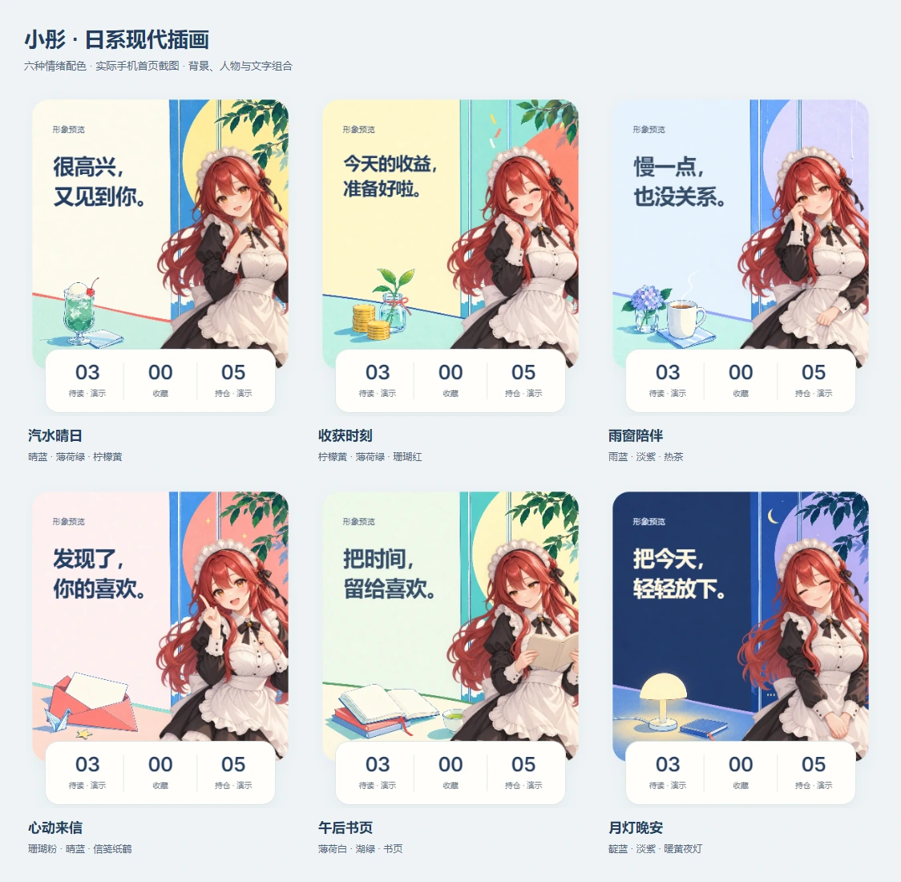

# V9 日系现代插画画报

整理日期：2026-10-13。用户明确选择「日系现代插画：清透配色、杂志感、二次元角色卡面」。

## 参考与判断

以下结论来自官方网站的实际页面观察，是项目适配判断，不是热度排名或用户研究。

| 来源 | 实际观察 | 适用与取舍 |
| --- | --- | --- |
| [《蔚蓝档案》日本官网](https://bluearchive.jp/) | 实际加载首页，观察天空蓝、白色云层、城市剪影与清亮高光 | 适合二次元角色的清透底色和冷暖对比；不照搬科幻设施、密集下载入口或网点效果 |
| [《学园偶像大师》官网](https://gakuen.idolmaster-official.jp/) | 实际加载首页，观察大面积白底、橙色细线、几何边界与角色影像 | 适合角色画报的留白与局部强调；不把广告横幅、巨大英文、视频和品牌标识搬到个人首页 |
| [《花与梦》2025 年第 20 期官方介绍](https://www.hakusensha.co.jp/news/76388/) | 读取官方介绍并查看封面，观察浅色人物插画与高彩度粉、青点缀 | 适合人物与点缀色关系；杂志封面的密集标题不适合需要实时数据的手机首页 |
| [Pokémon Peaceful Place 官网](https://www.pokemon.jp/special/pokepeace/) | 实际加载首页，观察柔和轮廓、蓝黄配色与生活场景物件 | 适合克制的日常氛围；本项目保留现有红发人物，不改成幼态吉祥物，不套用整套褐色描边 |

没有转载第三方插画或标识。背景由内置 `image_gen` 新生成，参考的是构图、色彩比例和内容层级。

## 完整首页试稿

- A「晴空喫茶」：晴蓝窗光、透明汽水与日常室内场景，空间感较强；叠加人物后背景细节略多。
- B「汽水画报」：奶白留白、蓝色切面、薄荷绿桌面、柠檬黄圆面与少量珊瑚红，平面杂志感更强。
- 两稿都通过真实浏览器叠加现有人物、动态文案、统计条及收益卡检查，避免仅凭单独背景作判断。

## 构图与配色约束

- 保留原六套透明人物，背景独立生成，不将人物、业务数字、品牌或文字烘焙进图片。
- 主文案从左侧 8%、顶部 19% 开始，占封面宽度 44%、高度 44%；这个区域必须保持低细节和稳定明度。
- 人物继续位于右侧；背景大色块衬托红发，细节集中于左下和右上，底部保留统计条叠放余量。
- 点缀色选择蓝、薄荷绿、柠檬黄、珊瑚红；不使用欧式拱门、玫瑰花柱、金色花纹。
- 情绪靠场景物件、天气和配色共同表达；不只给同一张画加六层色彩滤镜。
- 首页外围同步使用浅蓝纸面、深蓝文字、白色统计条。数字维持盈利红色、亏损绿色，演示标记和业务含义清晰。
- 文案仍最多 28 个可见字符、4 行、16–44px；资源预加载、退出与入场时序、手动选择和减少动态效果保持现有规则。

生成提示词另存为 `v9-japanese-editorial-prompts.json`。工作过程中的第三方页面截图保存在忽略的本地目录，没有加入公开仓库。

## 素材与实现

采用 B「汽水画报」作为工作方向，六个场景分别为汽水晴日、收获时刻、雨窗陪伴、心动来信、午后书页、月灯晚安。原图均为 1254 × 1254，PNG 与 WebP 存放于 `src/home/art/scene-editorial-*-v9.*`，单张 WebP 约 102–123 KiB。设置中的预览同步采用深蓝文字，夜间预览使用奶白文字和深蓝遮罩。

首页画布与浏览器主题色同步；详情、设置继续使用现有深色表面。PWA 的启动底色改为浅蓝，iOS 状态栏声明改用默认样式。自动切换配置、模块规则、数据接口与已有收藏没有因视觉更新而改写。

## 验证记录

- 构建及 50 项现有测试通过；UI 资料库校验通过，当前为 31 条原创提示词、59 条来源评审。
- Chromium 在 320、393、768px 和 WebKit 在 393px 分别检查六个场景，共 24 个组合；没有横向溢出、文字越出安全区、意外裁切或双人物。
- 320、393px 分别检查盈利、亏损、28 字限制、四行短句和数据不可用状态，共 10 个组合；金额不拆散，文案最多 4 行、最小 16px，自动化可访问性扫描未发现违规项。
- Chromium 与 WebKit 检查首页、心情浮层、理财详情、设置与返回，主题色按页面恢复；原来的整页蓝色焦点框修复保持有效。
- 上述为本地浏览器模拟检查，不宣称已经做过实体 iPhone 或完整 WCAG 认证。
